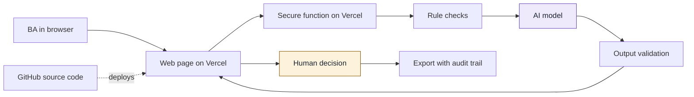

## 9. How it works and how AI stays under control

### 9.1 How AI works in the tool

| Stage | Done by | What happens |
|---|---|---|
| Input | Person | {{what the BA provides}} |
| Rule checks | Rules | {{checks that need no AI}} |
| Analysis or drafting | AI | {{what AI produces}} |
| Validation | Rules | Every AI result must match the agreed format and quote its source text. Anything else is removed |
| Decision | Person | The BA accepts, edits or rejects each result |
| Export | Tool | The output records what was decided, with the prompt version, model and time |

### 9.2 Architecture and tech stack

Purple is AI and amber is the human decision.

| Part | Choice | Why |
|---|---|---|
| Hosting, screens and backend | Vercel | One place to run everything, with no servers to manage. The secure function keeps the AI key out of the browser |
| Source code | GitHub | Full history of every change, and automatic deployment |
| AI model | {{provider and model}} | {{reason}} |
| Database and storage | None at Level 1 | Storing nothing reduces data risk. Supabase is the next step if history is needed |

### 9.3 Data safety

- **What the tool receives:** {{data types}}. It's used with fictional data only.
- **Where data goes:** {{browser, Vercel function, AI provider}}
- **What's kept:** {{Level 1: nothing is stored by the tool. Exports stay with the user.}}
- **Access:** The AI key stays on the server, and the tool requires an access code.
- **Before real use:** {{approvals needed for hosting, AI provider and data classification}}

### 9.4 Human control points

| Control point | Who decides | What happens without approval |
|---|---|---|
| {{point}} | {{role}} | {{consequence}} |
