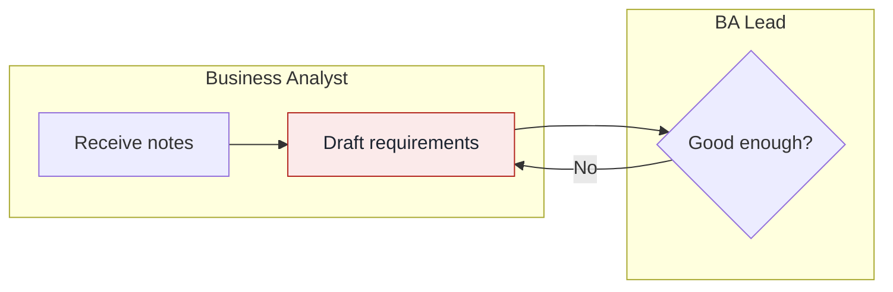

# Workflow diagrams

Every workflow has a steps table and a Mermaid diagram. Write the table first, because it's the source and the diagram is its picture.

## Rules

- Use `flowchart LR`, with one `subgraph` lane per actor.
- Give nodes the IDs `S1`, `S2` and so on, matching the step numbers in the table.
- Keep to 12 steps or fewer. Merge detail into one step when you can.
- Keep labels to about 5 words, always in double quotes, with no quote marks or line breaks inside.
- Use `{"Label?"}` for a decision and `["Label"]` for an action.
- Label decision branches, such as `S3 -- "No" --> S2`.

## Comparing as-is and to-be

The to-be diagram must look like an edited copy of the as-is diagram:

- Use the same lanes in the same order.
- Keep the same node ID for a step that continues to exist, and add new IDs after the highest as-is number.
- Keep the same left-to-right order.

## Highlight classes

Include these lines at the end of every diagram, and apply only the classes you use.

| Class | Use it for | Used in |
|---|---|---|
| `pain` | A step with a pain point | As-is |
| `changed` | A step the tool changes or adds | To-be |
| `human` | A human decision or review | To-be |
| `ai` | A step AI performs | To-be, feature workflows |

Add a one-line legend under each diagram that uses these colors.
