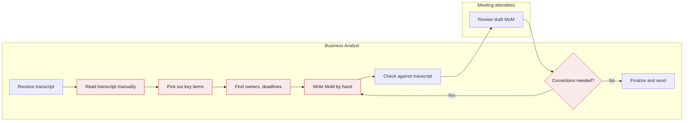
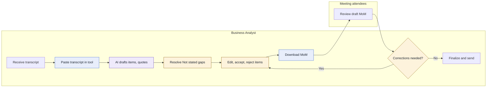
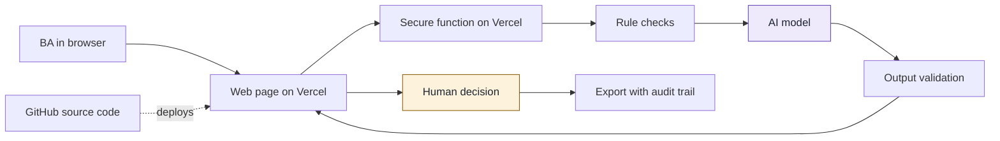

# Deck brief

Build a 16:9 presentation from this file for BA managers.

- **Style:** clean and professional, with plenty of white space, large readable text and one accent color. One message per slide.
- **Headline:** use each slide's Headline as its title.
- **Diagrams:** redraw Mermaid code as clean diagrams. S03 and S05 must share one layout so that the differences stand out.
- **Numbers:** keep each number's visible "measured" or "assumption" label. Drop the bracket tags from the slide itself.
- **Hidden lines:** don't show the Source, Link or Note lines on the slides. They're for the team.
- **Content:** use only what's in this file. Don't add facts, numbers, logos or quotes.
- **Order:** keep the slide order. Backup slides go at the end, after a divider titled "Backup".

---

## S01 Tool summary

**Headline:** Business Analysts review a quote-backed MoM draft instead of writing every set of minutes by hand

**Content:**
MoM Drafter

For Business Analysts, MoM Drafter turns a raw meeting transcript into a structured Minutes of Meeting draft where every item is backed by a transcript quote, so that the BA reviews and decides instead of reading and writing everything by hand.

Why it matters: the gain in time and accuracy is still to be measured.

**Visual:** Tool name large, with the promise beneath it

**Source:** 1.1, 1.2

**Link:** "Here's the problem behind it."

---

## S02 Problem

**Headline:** BAs lose time reading transcripts by hand and still risk missing decisions, actions and owners

**Content:**
Meet Elena Marsh, a fictional Business Analyst at Tallowfield Mutual, a fictional company. She has just run the "Address change requirements review" meeting, about letting customers change their home address in the customer portal. She holds the raw transcript, attendees expect a MoM they can act on, and she is accountable for it.

Top pain points, most harmful first:
- Decisions, action items or discussion points are missed (stated by the judges).
- Reading the full transcript by hand takes a lot of time (stated by the judges).
- Owners and deadlines are unclear or absent and must be chased (assumption).

Problem statement: Business Analysts need accurate, structured Minutes of Meeting from raw transcripts because attendees and stakeholders rely on them for decisions and actions, but today the BA reads each transcript and writes the MoM by hand, which causes lost time and missed decisions, action items and discussion points.

**Visual:** Persona card for Elena Marsh with the meeting name, then the three pain points, then the problem statement. This one meeting is the thread for the rest of the deck.

**Source:** 2.2, 2.4, 2.5, 7.1

**Link:** "Here's where it happens today."

---

## S03 As-is workflow

**Headline:** The work goes wrong in the reading, picking, chasing and rewriting steps

**Content:**
Elena's steps today, with the pain points marked:
- Read the transcript manually from start to end: reading takes BA time away from analysis (P-02).
- Pick out discussion points, decisions and actions: items are missed, so the MoM is incomplete or wrong (P-01).
- Find the owner and deadline of each action: owners and deadlines are unclear and must be chased (P-03, assumption).
- Write the MoM by hand: layout and wording vary (P-04, assumption).
- Apply corrections after attendees review: the BA goes back to rewrite (P-05, assumption).

**Visual:**

Legend: red steps carry a pain point.

**Source:** 3.2, 3.3, 7.1

**Link:** "What if those steps worked differently?"

---

## S04 Solution

**Headline:** MoM Drafter gives the BA a first draft with proof behind every item, and leaves every decision to the BA

**Content:**
Solution: a web tool that drafts a structured MoM in which every item is backed by a quote from the transcript. It marks missing owners and deadlines as "Not stated", and leaves every decision to the BA.

Three core features:
- **CF-01 Structured MoM draft from a pasted transcript:** a first draft of discussion points, decisions and action items in one consistent layout.
- **CF-02 Evidence quotes and gap flags:** a transcript quote on every item, and "Not stated" with a suggested question for attendees where an owner or deadline is missing.
- **CF-03 Review, edit and download:** the BA accepts, edits or rejects each item and downloads a Word document that records those decisions.

Why this option: it scored highest of three options on value for BA work, live demo and ease of defence (scores are team judgement, not measurements), and it is the only one that produces the complete MoM the judges asked for.

Status: this is the approved design. The tool review (G5) is still to come.

**Visual:** Three feature blocks side by side, with the one-line "why this option" beneath and a small status tag.

**Source:** 5.1, 5.3, 5.5, 14.1

**Link:** "Here's how the work changes."

---

## S05 To-be workflow

**Headline:** The tool changes the reading and writing steps, and the BA still decides at every key point

**Content:**
Changed or new steps (blue):
- Paste the transcript into the tool, instead of reading it line by line.
- Download one Word file that records each decision, the prompt version, the model and the time.

AI step (purple):
- The tool drafts items, each with a quote.

Human reviews (amber):
- The BA resolves "Not stated" owners and deadlines with the attendees.
- The BA checks each item against its quote, then accepts, edits or rejects it. The check against the transcript now happens inside this step.
- The BA decides whether corrections are needed, fixes items in the tool and downloads again.
- The BA decides what is sent. The tool sends nothing.

**Visual:**

Legend: blue steps are changed or new, purple is AI, amber is a human decision.

**Source:** 6.1, 6.3, 6.4

**Link:** "Let's run it."

---

## S06 Live demo

**Headline:** Elena Marsh turns the Address change requirements review transcript into a checked Word MoM

**Content:**
Watch for:
1. Every item carries a quote from the transcript, and two actions show "Not stated" with a suggested question.
2. Names and dates on screen must appear in the transcript. Anything else becomes "Not stated".
3. Elena decides on every item, and the Word file records each decision.

**Visual:** None, this slide stays simple.

**Source:** 7.1, 7.2

**Note:** The presenter says whether the demo is live or Demo mode ("sample data, no AI"). The saved samples were prepared by hand, not captured from a live AI run [A-15, A-17]. The demo flow itself depends on the tool passing G5.

**Link:** "What did that change for a BA?"

---

## S07 Value for BA work

**Headline:** The BA's work shifts from writing to reviewing, and the time saving is still to be measured

**Content:**
What changes for a BA: less time reading line by line and writing from a blank page. Instead, the BA reviews a draft where every item points back to the transcript, missing owners and deadlines are listed up front, and corrections are made in the tool instead of by rewriting. The BA stays accountable for what is sent.

We make no claim yet about hours saved or errors avoided.

| Measure | Today | With the tool |
|---|---|---|
| Time from transcript to MoM ready to send | To be measured | To be measured |
| Decisions and actions found | To be measured | To be measured |
| Actions with owner and deadline stated or flagged "Not stated" | To be measured | To be measured |
| Items that can be traced to the transcript | To be measured | Every item carries a quote (by design) |
| MoM layout consistency | Varies by BA and meeting (assumption) [A-03] | One standard layout (by design) |

How we will measure: during rehearsal, one person does the same task on the same fictional sample by hand and with the tool, including review. This is a small test of one person and one sample. A pilot then measures more.

**Visual:** Before-and-after comparison. Cells that read "To be measured" are shown as empty slots, not as figures.

**Source:** 8.1, 8.3, 8.4, 7.1

**Note:** Provisional. Replace "To be measured" only with rehearsal results registered as SRC-xx in `assumptions.md`. Until then, do not add figures.

**Link:** "Why should you trust the output?"

---

## S08 AI under control

**Headline:** Rules check the AI, and the BA decides every item

**Content:**
- **Rules before AI:** empty or oversized text and a wrong access code are rejected, and no AI is involved.
- **AI drafts:** it reads the transcript and drafts items with quotes. It is told not to guess owners or deadlines.
- **Validation removes:** any result in the wrong format, any item whose quote is not in the transcript, and any owner or deadline not found in the transcript, which becomes "Not stated". The counts are shown on screen.
- **People decide:** the BA accepts, edits or rejects each item, and decides what is sent. The tool sends nothing.
- **Data safety:** fictional data only. The tool stores nothing, the AI key stays on the server, and an access code is required. Real data waits for approval of the AI provider, hosting and data classification.
- **What the checks do not prove:** a quote proves the text exists, not that the item means it, and a missed item cannot be seen. The BA review stays the main control.

Status: this is the approved design. The tool review (G5) is still to come.

**Visual:**

Purple is AI and amber is the human decision.

**Source:** 9.1, 9.2, 9.3, 9.4, 10.3, 14.1

**Link:** "Where does it still fall short?"

---

## S09 Limitations and risks

**Headline:** The tool cannot see what the AI left out, real data is not approved, and long meetings are untested

**Content:**
Three rows, limit or risk and mitigation:

1. **The tool cannot see what the AI left out (L-03).** A quote only proves the text exists. Mitigation: the BA reads each quote, decides every item and stays accountable. The pilot counts missed items.
2. **Real confidential content could be pasted into an outside AI service (R-02).** Mitigation: the tool is for fictional data only for now. Real use waits for approval of the provider, hosting and data classification.
3. **The 20,000-character limit is unmeasured (L-01, assumption [A-12]).** We do not claim the tool handles a full-length meeting. Mitigation: long meetings need shortening or several runs today, and the pilot measures realistic lengths before the limit is trusted.

**Visual:** Three rows: limit or risk on the left, mitigation on the right.

**Source:** 10.3

**Link:** "What would a wider rollout need?"

---

## S10 Roadmap

**Headline:** Reaching the whole department takes a pilot, hardening and a supported rollout, in that order

**Content:**
Stages, owners and what each needs. These are our proposal. No durations, headcounts or costs are given, because we have no basis for them.

1. **Pilot.** Owner: BA manager (pilot sponsor), with the Proposal lead. Find out with a small group of BAs whether reviewing a draft costs less than writing by hand, and whether the checks hold up on realistic material. Needs: a sponsor and pilot group, realistic fictional transcripts including long ones, approval of the AI provider and hosting for the pilot data, recorded measurements, and a written rule that only approved data may be pasted.
2. **Hardening.** Owner: Tool owner (to be named), with Security. Fix what the pilot shows: the transcript limit, the name and date check, the Word layout or company template, an optional download without the audit trail, and a decision on sign-in and history. Ends with a security and data owner sign-off.
3. **Department rollout.** Owner: BA department head. A named owner and support route, BA guidance and training, quality monitoring, and hosting and AI provider under company terms.

What rollout depends on: approved hosting, an approved AI provider with data terms, a data classification decision, ownership and support, BA training, and quality monitoring. Running cost is not estimated; the pilot estimates it.

**Visual:** Three stages from left to right, each with its owner, and the dependencies listed beneath.

**Source:** 11.1, 11.2, 11.3

**Link:** "Here's what we're asking for."

---

## S11 Close

**Headline:** We ask you to sponsor a small, time-boxed pilot, with fictional or approved data only

**Content:**
Lesson: our first spec said the tool "never guesses" an owner or a deadline. The independent review showed that only the AI prompt prevented it. We added a rule check, then rewrote our claims to say only what the check proves. State what a control proves and what it does not, and put the weak points in the document yourself.

Request: sponsor a small, time-boxed pilot of MoM Drafter. A BA manager would be the sponsor and choose a small group of BAs. IT and Security review the AI provider, hosting and data class in parallel. The pilot measures time to a ready MoM, items edited, rejected and missed, and the transcript length the tool can take, so the next decision rests on measurements and not on our claims. We are not asking for approval to use real client data.

**Visual:** The request, large.

**Source:** 12.1, 12.2

---

## B01 Judges' questions

**Headline:** The hardest questions have plain answers, including what we cannot yet say

**Content:**
- **What happens when the AI is wrong?** The BA sees the quote under each item and can edit or reject it. A result in the wrong format is not shown, and an item whose quote is not in the transcript is removed, with the count shown. We cannot catch a wrong reading of a real quote or a missed item, so the BA review stays the main control.
- **How do you stop it from making things up?** Three steps: the prompt says use only the transcript, the quote check removes items with no matching quote, and the name and date check replaces any owner or deadline not in the transcript with "Not stated". These do not prove the AI picked the right person, so we do not say it cannot make things up.
- **Who is accountable for the final output?** The Business Analyst. The tool sends nothing, and nothing is final until the BA decides on each item.
- **Could someone paste real client data into it?** Yes, the tool cannot tell. It shows a "fictional data only" notice and asks for an access code, but neither stops pasting. The pilot starts only with fictional or approved data.
- **How do we know this isn't vibe coding?** The proposal came first and the tool is built against a frozen spec. Four human reviews are approved, with named approvers and times, and the independent spec review found ten issues that were fixed before the freeze. The tool review (G5) is still to come.
- **Where did your team overrule the AI?** At the spec freeze the reviewer suggested measuring the transcript limit or raising it. The team accepted it as an open flag and chose to record a long-meeting limitation instead. Changes made while building are added after G5.

**Source:** 13.3, 13.5, 13.6

---

## B02 Tech stack

**Headline:** A small stack keeps the key safe, the data minimal and the model replaceable

**Content:**
- **Vercel (hosting, screens and backend):** one place to run everything, with no servers to manage. The secure function keeps the AI key out of the browser.
- **GitHub (source code):** full history of every change, and automatic deployment.
- **Claude through Anthropic's official SDK:** reads long text well and returns the structured format the validator needs. The model name is set in server settings, so it can change without editing code.
- **No database at Level 1:** storing nothing reduces data risk. Supabase is the next step if history is needed.

**Visual:**

Purple is AI and amber is the human decision.

**Source:** 9.2

---

## B03 How we built it

**Headline:** The proposal came first and four human reviews are approved, with two still to come

**Content:**
Process: we treated this as BA work, with AI doing the drafting and people making the decisions. The proposal came first, then the tool and slides were built from the approved proposal. Specialist subagents each wrote named documents from templates, and an independent reviewer checked the spec and, later, the final pack. Six human reviews control the work. The reviewer's advice is not an approval: only a named person approves each gate.

Folder structure:
- `CLAUDE.md`: rules every AI session follows
- `RUNBOOK.md`: our timeline, roles and scope-cut rules
- `STATUS.md`: review log
- `.claude/`: subagents, skills, templates and tool build rules
- `deliverables/`: proposal, assumptions, slides, notes, reviewer reports
- `our-tool/`: the deployed tool

Review log:

| Gate | Review | Decider | Status | Approved at |
|---|---|---|---|---|
| G1 | Problem framing | Ngan (C), approved by Viet | Approved | 2026-11-02 03:51 |
| G2 | Solution choice | Team (A), approved by Viet | Approved | 2026-11-02 03:54 |
| G3 | Design | Phong (B) | Approved | 2026-11-02 03:59 |
| G4 | Spec freeze | Phong (B), approved by Viet | Approved | 2026-11-02 04:13 |
| G5 | Tool freeze | Ngan (C) | Pending | Not yet reviewed |
| G6 | Final pack and go/no-go | Viet (A) | Pending | Not yet reviewed |

For G1, G2 and G4 the person who approved is not the decider named in the gate table. We record this as it stands.

**Source:** 14.1, 14.2, 14.3, 14.4

**Note:** Provisional. Update the review log and the "where people changed the AI's work" content after G5 and at `/ba-closeout final`.

---

## B04 AI checklist

**Headline:** Every responsible-AI area is Planned in the approved design, and none is yet proven on a running tool

**Content:**
Status is Planned for every area until someone has opened the real tool or its tests (after G5). The evidence today is the approved spec, which says what we will build and is not proof that it works.

| Area | Where we stand (by design) | Status |
|---|---|---|
| Accountability | The BA is accountable and decides what is sent. The tool sends nothing. The audit trail does not record the BA's name | Planned |
| Responsibility | AI drafts, rules check, the BA decides. Results carry an AI or Rule badge | Planned |
| Human oversight | Nothing is final until the BA accepts, edits or rejects. Undecided items are marked "Not reviewed", and the download is not blocked | Planned |
| Auditability | The Word file records prompt version, model, times and each decision, but not the BA's name. Items removed by the checks appear only as counts on screen | Planned |
| Transparency | AI, Rule, "Entered by BA" and Demo mode labels. Demo samples were prepared by hand | Planned |
| Accuracy | Four layers: format check, quote check, name and date check, BA review. None detects a missed item. Accuracy on real transcripts is not measured | Planned |
| Security | AI key on the server only, an access code required. One shared code, no individual sign-in, no security review done | Planned |
| Data privacy | Fictional text only for now. The tool stores nothing. The provider's retention and terms are unchecked | Planned |
| Fairness | It could disadvantage a person if an owner is wrong or missing. Not tested for bias | Planned |
| Reliability | Plain failure message, transcript kept, Demo mode offered. Live reliability is not measured | Planned |
| Cost control | Oversize input rejected before any AI call, one AI call per run, no retry. No per-person quota and no cost estimate | Planned |
| Compliance | Needs approval of the provider, hosting and data classification, an owner, and company policies we have not checked | Planned |

**Source:** 15

**Note:** Provisional. Rows move to Yes, Partial or No only after G5, with evidence someone can open.

---

## B05 Options compared

**Headline:** Option A scored highest, on team judgement and not on measurements

**Content:**
Weights come from an assumed scoring rubric [A-01]. Scores from 1 to 5 are team judgement, not measurements [A-08], and no web research backed them.

| Criterion | Weight (assumption) | Option A: Evidence-linked MoM drafter | Option B: Action and decision register with gap chaser | Option C: MoM completeness checker |
|---|---|---|---|---|
| Value for BA work | 30 [A-01] | 5 | 3 | 3 |
| Working tool and smooth demo | 25 [A-01] | 5 | 4 | 3 |
| AI quality control and data safety | 20 [A-01] | 4 | 5 | 5 |
| Presentation and Q&A | 15 [A-01] | 5 | 3 | 3 |
| Creativity | 10 [A-01] | 3 | 4 | 4 |
| **Weighted score** | | **92** | **75** | **70** |

Scores are team judgement [A-08].

Why A: it meets the judges' stated outcome, helps the BA the most and demos in one pass. Its quality-control weakness is handled by quotes, "Not stated" flags and the BA edit before download. Option B's gap flags are folded into A.

The choice would change if the MoM must follow a fixed company template, if the judges value checking BA-written MoMs over generating them, or if tests show review costs more than it saves.

**Source:** 4.2, 4.3, 4.4

---

## B06 Assumptions

**Headline:** The proposal rests on open assumptions, and no measurement has been recorded yet

**Content:**
Every assumption below is Open. The register of measured sources has no entries yet.

- **How BAs work today (A-02 to A-07):** the process starts with a raw text transcript; the BA writes the MoM by hand with no fixed template; the BA is accountable; attendees review and carry out actions; owners and deadlines are often unclear; the transcript is English and covers one meeting.
- **Scores and weights (A-01, A-08, A-21):** the scoring rubric is assumed, and the option scores and risk ratings are team judgement.
- **Output (A-09, A-10, A-13):** the MoM is a Word file, pending the judges' answer. Rejected items are left out of the body and listed in the audit trail.
- **Level 1 behaviour (A-11, A-14):** nothing is stored beyond the browser page, and the transcript is kept as pasted.
- **Input limit (A-12):** 20,000 characters per run, a working figure not measured on real transcripts.
- **Checks (A-16):** the name and date check is exact-text matching, not tested on real transcripts. It cannot prove the AI picked the right person.
- **Samples (A-15, A-17):** both saved samples were prepared by hand, not captured from a live AI run. One has a planted quote on purpose.
- **Rollout (A-18, A-19, A-20):** the three stages are our proposal, no running cost has been estimated, and the company approval routes are our reading, not confirmed.

Questions for the judges with working answers: transcript form (pasted text), output format (Word), MoM template (none), who checks before sending (BA, then attendees), and language and scope (English, one meeting). No answers received yet.

**Source:** assumptions.md, questions.md

---

## B07 Appendix

**Headline:** One screen, five Must functions and four actors make up the tool

**Content:**
Actors:
- **ACT-01 Business Analyst:** turns a transcript into an accurate MoM, checks every item and decides what goes in the file that is sent.
- **ACT-02 Meeting attendees:** answer the BA's questions about missing owners and deadlines, then review the Word file. They do not use the tool.
- **ACT-03 AI model:** reads the transcript, drafts items with quotes and marks gaps as "Not stated".
- **ACT-04 MoM Drafter:** applies the rule checks, removes results that fail validation, holds the BA's decisions and builds the Word file.

Must functions (Level 1: no sign-in, no database):
- **FN-01** Check input rules, then draft the MoM items with quotes and gap flags (AI)
- **FN-02** Validate the AI result and drop items whose quote is not in the transcript (Rule)
- **FN-03** Review items: check the quote, resolve gaps, then Accept, Edit or Reject (UI)
- **FN-04** Download the MoM as a Word file with an audit trail (Export)
- **FN-05** Demo mode: run the whole flow from saved samples, with no server and no AI (UI)

Screen:
- **SCR-01 MoM Drafter workspace:** paste a transcript, get a draft with quotes and gap flags, decide on every item, and download the Word file. Demo mode is a state of this screen.

Specified but not built until the spec is met and time remains: click a quote to highlight it (Should), copy accepted items as text (Could), and add an item the AI missed (Could).

**Source:** A1, A3, A4
