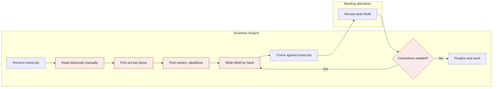
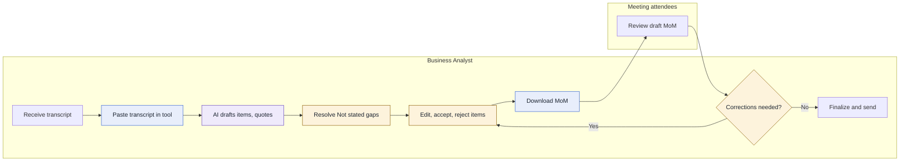
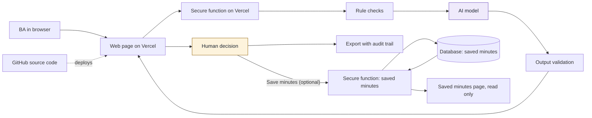

# Deck brief

Build a 16:9 presentation from this file for BA managers.

- **Style:** clean and professional, with plenty of white space, large readable text and one accent color. One message per slide.
- **Headline:** use each slide's Headline as its title.
- **Diagrams:** redraw Mermaid code as clean diagrams. S03 and S05 must share one layout so that the differences stand out.
- **Numbers:** keep each number's visible "measured" or "assumption" label. Drop the bracket tags from the slide itself.
- **Hidden lines:** don't show the Source, Link or Note lines on the slides. They're for the team.
- **Content:** use only what's in this file. Don't add facts, numbers, logos or quotes.
- **Order:** keep the slide order. Backup slides go at the end, after a divider titled "Backup".

---

## S01 Tool summary

**Headline:** Business Analysts review a quote-backed MoM draft instead of writing every set of minutes by hand

**Content:**
MoM Drafter

For Business Analysts, MoM Drafter turns a raw meeting transcript into a structured Minutes of Meeting draft where every item is backed by a transcript quote, so that the BA reviews and decides instead of reading and writing everything by hand.

Why it matters: the gain in time and accuracy is still to be measured.

Status: built and deployed to the frozen spec at Level 1 (no sign-in), with the AI model claude-haiku-5-5 and prompt v1. After the freeze we added one function: in live mode the BA can save the reviewed minutes, never the transcript, and open them again on a read-only page. That makes the tool Level 1 plus storage (a database, no sign-in), and everyone with the access code shares one workspace. Saving works on its branch preview and is not on production until the branch is merged. Tried only on a few short fictional transcripts.

**Visual:** Tool name large, with the promise beneath it and a small status tag

**Source:** 1.1, 1.2, 1.3

**Link:** "Here's the problem behind it."

---

## S02 Problem

**Headline:** BAs lose time reading transcripts by hand and still risk missing decisions, actions and owners

**Content:**
Meet Elena Marsh, a fictional Business Analyst at Tallowfield Mutual, a fictional company. She has just run the "Address change requirements review" meeting, about letting customers change their home address in the customer portal. She holds the raw transcript, attendees expect a MoM they can act on, and she is accountable for it.

Top pain points, most harmful first:
- Decisions, action items or discussion points are missed (stated by the judges).
- Reading the full transcript by hand takes a lot of time (stated by the judges).
- Owners and deadlines are unclear or absent and must be chased (assumption).

Problem statement: Business Analysts need accurate, structured Minutes of Meeting from raw transcripts because attendees and stakeholders rely on them for decisions and actions, but today the BA reads each transcript and writes the MoM by hand, which causes lost time and missed decisions, action items and discussion points.

**Visual:** Persona card for Elena Marsh with the meeting name, then the three pain points, then the problem statement. This one meeting is the thread for the rest of the deck.

**Source:** 2.2, 2.4, 2.5, 7.1

**Link:** "Here's where it happens today."

---

## S03 As-is workflow

**Headline:** The work goes wrong in the reading, picking, chasing and rewriting steps

**Content:**
Elena's steps today, with the pain points marked:
- Read the transcript manually from start to end: reading takes BA time away from analysis (P-02).
- Pick out discussion points, decisions and actions: items are missed, so the MoM is incomplete or wrong (P-01).
- Find the owner and deadline of each action: owners and deadlines are unclear and must be chased (P-03, assumption).
- Write the MoM by hand: layout and wording vary (P-04, assumption).
- Apply corrections after attendees review: the BA goes back to rewrite (P-05, assumption).

**Visual:**

Legend: red steps carry a pain point.

**Source:** 3.2, 3.3, 7.1

**Link:** "What if those steps worked differently?"

---

## S04 Solution

**Headline:** MoM Drafter gives the BA a first draft with proof behind every item, and leaves every decision to the BA

**Content:**
Solution: a web tool that drafts a structured MoM in which every item is backed by a quote from the transcript. It marks missing owners and deadlines as "Not stated", and leaves every decision to the BA.

Three core features:
- **CF-01 Structured MoM draft from a pasted transcript:** a first draft of discussion points, decisions and action items in one consistent layout.
- **CF-02 Evidence quotes and gap flags:** a transcript quote on every item, and "Not stated" with a suggested question for attendees where an owner or deadline is missing.
- **CF-03 Review, edit and download:** the BA accepts, edits or rejects each item and downloads a Word document that records those decisions. In live mode the BA can also save the reviewed minutes and read them again (FN-09, read only).

Why this option: it scored highest of three options on value for BA work, live demo and ease of defence (scores are team judgement, not measurements, and were not redone for the saving change), and it is the only one that produces the complete MoM the judges asked for.

Status: the five Must functions are built to the frozen spec, with no changes to them. Three optional functions (FN-06 to FN-08) were cut to protect the build window. After the freeze, Viet decided on 2026-11-03 to add one Should function, saving reviewed minutes (FN-09), and a second screen, Saved minutes. It is live mode only and not in Demo mode. The raw transcript is never saved. No review has approved this change. It works on its branch preview and is not on production until the branch is merged. Still 3 core features and 2 screens.

**Visual:** Three feature blocks side by side, with the one-line "why this option" beneath and a small status tag.

**Source:** 5.1, 5.2, 5.3, 5.5, 1.3, 14.1, 14.4, A3.1, A4.1

**Link:** "Here's how the work changes."

---

## S05 To-be workflow

**Headline:** The tool changes the reading and writing steps, and the BA still decides at every key point

**Content:**
Changed or new steps (blue):
- Paste the transcript into the tool, instead of reading it line by line.
- Download one Word file that records each decision, the prompt version, the model and the time.

AI step (purple):
- The tool drafts items, each with a quote.

Human reviews (amber):
- The BA resolves "Not stated" owners and deadlines with the attendees.
- The BA checks each item against its quote, then accepts, edits or rejects it. The check against the transcript now happens inside this step.
- Optional, live mode only: the BA chooses whether to save the reviewed minutes. Saving is never automatic, nothing is stored if the BA does not choose it, and the Word download works either way. The diagram below does not show this optional step.
- The BA decides whether corrections are needed, fixes items in the tool and downloads again.
- The BA decides what is sent. The tool sends nothing.

**Visual:**

Legend: blue steps are changed or new, purple is AI, amber is a human decision.

**Source:** 6.1, 6.3, 6.4, 9.4

**Link:** "Let's run it."

---

## S06 Live demo

**Headline:** Elena Marsh turns the Address change requirements review transcript into a checked Word MoM

**Content:**
Watch for:
1. Every item carries a quote from the transcript, and two actions show "Not stated" with a suggested question.
2. Names and dates on screen must appear in the transcript. Anything else becomes "Not stated".
3. Elena decides on every item, and the Word file records each decision.

**Visual:** None, this slide stays simple.

**Source:** 7.1, 7.2

**Note:** The presenter says whether the demo is live or Demo mode ("sample data, no AI"). Demo mode shows the saved sample as written, and the saved samples were prepared by hand, not captured from a live AI run [A-15, A-17]. A live run may word items differently: in one check the lookup-service deadline read "ideally before the design review" where the saved sample reads "before the design review", and the same two gaps were flagged. Do not promise the saved result in a live run (7.4). Do not claim offline use, network-log checks or failure with the AI off: they were not confirmed on the live site (L-11, 7.5). The Word file does not show the removed and replaced counts (L-10), so point to the counts on screen. Saving is not part of the demo story in section 7. If the presenter shows saving, it must be in live mode with the access code: the "Save minutes" button is disabled in Demo mode, so Demo mode cannot save (FN-09, FN-05). Saving was confirmed by a person on the branch's Vercel preview only. Opening a saved record, the list page and production after the merge are not confirmed by anyone (L-15), so do not claim them. Fictional data only (R-02).

**Link:** "What did that change for a BA?"

---

## S07 Value for BA work

**Headline:** The BA's work shifts from writing to reviewing, and the time saving is still to be measured

**Content:**
What changes for a BA: less time reading line by line and writing from a blank page. Instead, the BA reviews a draft where every item points back to the transcript, missing owners and deadlines are listed up front, and corrections are made in the tool instead of by rewriting. The BA stays accountable for what is sent. In live mode the BA can also save the reviewed minutes and read them again. The saved page is read only, so it keeps a record but does not make corrections cheaper, and we have no measurement of whether a saved record helps a BA.

We make no claim yet about hours saved or errors avoided. No measurement exists: no by-hand or with-tool timing was recorded, and the register of sources is empty. Pending: timing still to be measured.

| Measure | Today | With the tool |
|---|---|---|
| Time from transcript to MoM ready to send | To be measured | To be measured |
| Decisions and actions found | To be measured | To be measured |
| Actions with owner and deadline stated or flagged "Not stated" | To be measured | To be measured |
| Items that can be traced to the transcript | To be measured | Every item carries a quote (by design) |
| MoM layout consistency | Varies by BA and meeting (assumption) [A-03] | One standard layout (by design) |

How we will measure: during rehearsal, one person does the same task on the same fictional sample by hand and with the tool, including review. This is a small test of one person and one sample. A pilot then measures more.

**Visual:** Before-and-after comparison. Cells that read "To be measured" are shown as empty slots, not as figures.

**Source:** 8.1, 8.3, 8.4, 7.1

**Note:** Pending: waiting for a rehearsal timing (one person, one fictional sample, by hand and with the tool). Replace "To be measured" only with results registered as SRC-xx in `assumptions.md`. Until then, do not add figures. A small live check on the main sample gave a draft with no items dropped and no values replaced; say it is an observation, not a measurement of accuracy (8.3). The saved-minutes sentence comes from 8.1 and carries no measurement. Do not say saving saves time.

**Link:** "Why should you trust the output?"

---

## S08 AI under control

**Headline:** Rules check the AI, and the BA decides every item

**Content:**
- **Rules before AI:** empty or oversized text and a wrong access code are rejected, and no AI is involved.
- **AI drafts:** it reads the transcript and drafts items with quotes. It is told not to guess owners or deadlines.
- **Validation removes:** any result in the wrong format, any item whose quote is not in the transcript, and any owner or deadline not found in the transcript, which becomes "Not stated". The counts are shown on screen.
- **People decide:** the BA accepts, edits or rejects each item, and decides what is sent. The tool sends nothing. The Word file records each decision with the prompt version, model and time.
- **Saving is the BA's choice (optional, live mode only):** the BA chooses "Save minutes". It is never automatic, and Demo mode cannot save. The server checks the access code and the size and shape of the data, then stores the reviewed items and decisions. No AI is involved. The server cannot re-run the quote check because it does not have the transcript (L-14).
- **Data safety:** fictional data only. The raw transcript is never saved, and no transcript text is logged. Only when the BA chooses Save minutes, the reviewed items and decisions go into a database, including rejected and not reviewed items and each item's quote, which is a short extract of the transcript. The AI key and the database key stay on the server, and an access code is required. There is no per-user sign-in: everyone with the access code shares one workspace and can read every saved record, and the tool cannot edit or delete one (L-12, R-10). Real data waits for approval of the AI provider and hosting (including the database), a data classification, per-user sign-in, and a retention and delete rule.
- **What the checks do not prove:** a quote proves the text exists, not that the item means it, and a missed item cannot be seen. A saved record is what the browser sent, not proof that its quotes are real (L-14). The BA review stays the main control.
- **What is not in the Word file:** how many items the checks removed or replaced. Those counts appear on screen, and the Saved minutes page is built to show them for a saved record (L-10).

Status: built (Level 1 plus storage, claude-haiku-5-5, prompt v1). Only Haiku was tried, on a few short fictional transcripts. Saving was confirmed by a person on the branch preview only. Not confirmed: opening a saved record, the list page, production after the merge (L-15), offline use, network-log checks and failure with the AI switched off (L-11).

**Visual:**

Purple is AI and amber is the human decision. The save path has no AI step, and the transcript does not take it: only the reviewed items and decisions go to the database.

**Source:** 9.1, 9.2, 9.3, 9.4, 10.1, 10.2, 10.3

**Link:** "Where does it still fall short?"

---

## S09 Limitations and risks

**Headline:** The tool cannot see what the AI left out, real data is not approved and saved minutes are shared, and long meetings are untested

**Content:**
Three rows, limit or risk and mitigation:

1. **The tool cannot see what the AI left out (L-03).** A quote only proves the text exists. Mitigation: the BA reads each quote, decides every item and stays accountable. The pilot counts missed items.
2. **Real confidential content could be pasted into an outside AI service, and if the BA saves the minutes, extracts of it are stored in a list that everyone with the access code can read, with no delete in the tool (R-02, L-12, R-10).** There is no per-user sign-in. Mitigation: the tool is for fictional data only for now, and saving is the BA's choice. Real use waits for approval of the provider, hosting and data classification, per-user sign-in, and a retention and delete rule.
3. **The 20,000-character limit is unmeasured (L-01, assumption [A-12]).** We do not claim the tool handles a full-length meeting. Mitigation: long meetings need shortening or several runs today, and the pilot measures realistic lengths before the limit is trusted.

Also stated openly, in smaller type:
- The Word audit trail does not show how many items the checks removed or replaced (L-10).
- A saved record is taken from what the browser sends, so the server does not check its quotes or audit values (L-14). A saved record can be mistaken for final minutes, so the page labels every decision, and the Word file is what the BA sends (R-12).
- Saved minutes have working limits that were not measured, and the list shows only the newest records (L-13). The database key sits in Vercel settings, including the preview, and who can see them was not checked (R-11).
- Saving was confirmed on the branch preview only. Opening a saved record, the list page and production after the merge are not confirmed by anyone (L-15).
- Several behaviours were not confirmed on the live site: offline use, network-log checks, failure with the AI off, other browsers and a narrow-window layout (L-11).

**Visual:** Three rows: limit or risk on the left, mitigation on the right, with the "also stated openly" list beneath.

**Source:** 10.3, 10.1, 10.2

**Link:** "What would a wider rollout need?"

---

## S10 Roadmap

**Headline:** Reaching the whole department takes a pilot, hardening and a supported rollout, in that order

**Content:**
Stages, owners and what each needs. These are our proposal. No durations, headcounts or costs are given, because we have no basis for them.

1. **Pilot.** Owner: BA manager (pilot sponsor), with the Proposal lead. Find out with a small group of BAs whether reviewing a draft costs less than writing by hand, and whether the checks hold up on realistic material. Needs: a sponsor and pilot group, realistic fictional transcripts including long ones, approval of the AI provider and hosting for the pilot data, recorded measurements, and a written rule that only approved data may be pasted. We would ask that per-user sign-in, a retention rule and delete for saved minutes are part of the pilot's entry conditions.
2. **Hardening.** Owner: Tool owner (to be named), with Security. Fix what the pilot shows: the transcript limit, the name and date check, the Word layout or company template, and an optional download without the audit trail. For saved minutes: per-user sign-in so a BA sees only the records they may see, a retention rule, delete, a decision on whether a saved record may be edited, paging and search beyond the newest records, record limits set from measured sizes, a decision on whether the server should verify saved content, and a security review that covers who can see the Vercel settings and the database key. Ends with a security and data owner sign-off.
3. **Department rollout.** Owner: BA department head. A named owner and support route, BA guidance and training, quality monitoring, and hosting and AI provider under company terms.

What rollout depends on: approved hosting (for the web host and for the separate database that holds saved minutes), an approved AI provider with data terms, a data classification decision (including whether minutes may be saved in a database), ownership and support, BA training, and quality monitoring. Running cost is not estimated; the pilot estimates it. Everything here is still proposal and nothing has been started.

**Visual:** Three stages from left to right, each with its owner, and the dependencies listed beneath.

**Source:** 11.1, 11.2, 11.3, 12.2

**Link:** "Here's what we're asking for."

---

## S11 Close

**Headline:** We ask you to sponsor a small, time-boxed pilot, with fictional or approved data only

**Content:**
Lesson: our first spec said the tool "never guesses" an owner or a deadline. The independent review showed that only the AI prompt prevented it. We added a rule check, then rewrote our claims to say only what the check proves. State what a control proves and what it does not, and put the weak points in the document yourself.

Request: sponsor a small, time-boxed pilot of MoM Drafter. A BA manager would be the sponsor and choose a small group of BAs. IT and Security review the AI provider, hosting and data class in parallel. The pilot measures time to a ready MoM, items edited, rejected and missed, and the transcript length the tool can take, so the next decision rests on measurements and not on our claims. We are not asking for approval to use real client data. The prototype was frozen at Level 1. After the freeze the team added one function that stores reviewed minutes in a database that everyone with the access code can read, so the tool is now Level 1 plus storage and the pilot would not start with real data on it. It has been tried only on a few short fictional transcripts with one model, so a pilot is the next step to test it, not a claim that it is ready. We would ask that per-user sign-in, a retention rule and delete for saved minutes are part of the pilot's entry conditions.

The build repeated the lesson: the live AI result differed from our hand-prepared sample, and the Word audit trail does not show the removed and replaced counts. We list both as limits, not features. Saving was one more case: when it was added after the freeze, our claim "nothing is stored" had to be corrected.

**Visual:** The request, large.

**Source:** 12.1, 12.2

---

## B01 Judges' questions

**Headline:** The hardest questions have plain answers, including what we cannot yet say

**Content:**
- **What happens when the AI is wrong?** The BA sees the quote under each item and can edit or reject it. A result in the wrong format is not shown, and an item whose quote is not in the transcript is removed, with the count shown. We cannot catch a wrong reading of a real quote or a missed item, so the BA review stays the main control.
- **How do you stop it from making things up?** Three steps: the prompt says use only the transcript, the quote check removes items with no matching quote, and the name and date check replaces any owner or deadline not in the transcript with "Not stated". These do not prove the AI picked the right person, so we do not say it cannot make things up.
- **Who is accountable for the final output?** The Business Analyst. The tool sends nothing, and nothing is final until the BA decides on each item.
- **Who can read the stored minutes?** Anyone who has the access code, because there is no per-user sign-in: everyone shares one workspace and can list and open every saved record. The database has no public access, so only the server can read it, but anyone with access to the database project could too. The raw transcript is never saved, but each saved item keeps its quote, a short extract of the transcript, so extracts are stored. For that reason the tool is for fictional data only, and a real pilot would add per-user sign-in first.
- **Could someone paste real client data into it?** Yes, the tool cannot tell. It shows a "fictional data only" notice and asks for an access code, but neither stops pasting. The pilot starts only with fictional or approved data.
- **How do we know this isn't vibe coding?** The proposal came first and the tool was built against a frozen spec. Six human reviews (G1 to G6) are approved in the log, with named approvers and times, and the independent spec review found ten issues that were fixed before the freeze. The tool matched the frozen spec with no changes to FN-01 to FN-05, and three optional functions were cut. One function, saving reviewed minutes, was added after G5 by Viet's decision on 2026-11-03. No review has approved it, and it is outside the frozen spec, so we say so.
- **Where did your team overrule the AI?** At the spec freeze the reviewer suggested measuring the transcript limit or raising it. The team accepted it as an open flag and chose to record a long-meeting limitation instead. While building, the team made no spec changes and cut three optional functions (FN-06 to FN-08) to protect the build window.
- **Is the demo a real AI run?** It can run live or from the saved sample, and the presenter says which. The saved samples were prepared by hand, and live wording differs: in one live run a deadline read "ideally before the design review" where the saved sample reads "before the design review". Even the saved sample is re-checked at run time.
- **Does the Word file show how many items the checks removed?** No. Those counts appear on screen, and for a saved record the Saved minutes page shows them as an "At drafting" line when they are above zero. The spec did not ask for them in the file, and the team has not decided whether to add them.
- **What have you actually tested?** Automated tests cover the input rules, the format check, the quote check and the name and date check. On the live site the team ran a draft and a Word export and saw a wrong access code refused. These are small checks on a few short fictional transcripts with one model, not measured accuracy. We have not confirmed offline use, network-log checks, failure with the AI off, or a narrow-window layout.

**Source:** 13.3, 13.5, 13.6

---

## B02 Tech stack

**Headline:** A small stack keeps the keys on the server, stores only saved minutes and keeps the model replaceable

**Content:**
- **Vercel (hosting, screens and backend):** one place to run everything, with no servers to manage. The secure function keeps the AI key out of the browser.
- **GitHub (source code):** full history of every change, and automatic deployment.
- **Claude (AI model):** returns the structured format the validator needs. The model name is set in server settings, so it can change without editing code. The deployed model is claude-haiku-5-5 with prompt v1. Only Haiku was tried, on a few short fictional transcripts, so quality on other models or longer transcripts is unknown.
- **Supabase (database, for saved minutes only):** added after the spec freeze (FN-09). Level 1 plus storage: a database with no sign-in. The table has Row Level Security on and no public access, so only the secure function, using a server-only secret key, can read or write it. Nothing else is stored: not the transcript, not the access code. The rows are shared by everyone with the access code, and there is no delete. The saving feature is built on its branch and works on its Vercel preview. It is not on production until the branch is merged.

**Visual:**

Purple is AI and amber is the human decision. The save path has no AI step, and the transcript does not take it: only the reviewed items and decisions go to the database.

**Source:** 9.2, 9.3

---

## B03 How we built it

**Headline:** The proposal came first, and all six human reviews are approved, but the saved-minutes change came after them and no review covers it

**Content:**
Process: we treated this as BA work, with AI doing the drafting and people making the decisions. The proposal came first, then the tool and slides were built from the approved proposal. Specialist subagents each wrote named documents from templates, and an independent reviewer checked the spec and the final pack. Six human reviews control the work. The reviewer's advice is not an approval: only a named person approves each gate.

The tool was built in slices against the frozen spec: a demo path first, then a live path. The as-built record shows all five Must functions built, FN-06 to FN-08 cut, and no changes from the spec at G5.

A change after G5 and G6: on 2026-11-03 Viet (role A) decided to add saving of reviewed minutes to a database (FN-09, a Should function, and a second screen). It came after the freeze and after the final go decision, and no gate has reviewed it. The review log does not record whether the tool lead or the story lead agreed to it, and we do not claim they did. Until a person approves it through the review process, it stands as a decision by one person, not a reviewed change. It works on the branch's Vercel preview and is not on production until the branch is merged.

Folder structure:
- `CLAUDE.md`: rules every AI session follows
- `RUNBOOK.md`: our timeline, roles and scope-cut rules
- `STATUS.md`: review log
- `.claude/`: subagents, skills, templates and tool build rules
- `deliverables/`: proposal, assumptions, slides, notes, reviewer reports, as-built record
- `our-tool/`: the deployed tool

Review log (it has no row for the saved-minutes change, because no gate was run for it):

| Gate | Review | Decider | Status | Approved at |
|---|---|---|---|---|
| G1 | Problem framing | Ngan (C), approved by Viet | Approved | 2026-11-02 03:51 |
| G2 | Solution choice | Team (A), approved by Viet | Approved | 2026-11-02 03:54 |
| G3 | Design | Phong (B) | Approved | 2026-11-02 03:59 |
| G4 | Spec freeze | Phong (B), approved by Viet | Approved | 2026-11-02 04:13 |
| G5 | Tool freeze | Ngan (C), approved by Viet | Approved | 2026-11-02 07:55 |
| G6 | Final pack and go/no-go | Viet (A) | Approved | 2026-11-02 08:14 |

For G1, G2, G4 and G5 the person who approved (Viet) is not the decider named in the gate table. We record this as it stands and do not call it an independent review by the decider. G6 was approved by its decider (Viet), who also owns the proposal and made the later saved-minutes decision. The "12 of 12 Yes" control baseline at G5 is the tool lead's own record, and several Yes entries rest on tests and a headless-browser run, not on a person watching the live site.

Where people changed the AI's work: people cut three optional functions to protect the build window, and left the Word audit trail without the removed and replaced counts, recorded as a limitation. After G6 one person added saved minutes, and the proposal claims "nothing is stored" and "Level 1" were corrected to match. We do not claim which person made which edit.

**Source:** 14.1, 14.2, 14.3, 14.4, 14.5

---

## B04 AI checklist

**Headline:** Three responsible-AI areas are Yes, seven are Partial and two are No, and we say why for each

**Content:**
Status is Yes, Partial or No. Yes means the control exists in the code or tests we opened. It does not mean accuracy was measured, and several rows stay Partial because a person has not confirmed the behaviour on the live site. The rows that changed with saved minutes are Security and Data privacy, with Auditability and Compliance widened. No row was raised to Yes because of saving.

| Area | Where we stand | Status |
|---|---|---|
| Accountability | The BA is accountable and decides what is sent. The tool sends nothing. The audit trail does not record the BA's name, and the tool's own owner is not named | Partial |
| Responsibility | AI drafts, rules check, the BA decides. Results carry an AI or Rule badge, and BA-typed values show "Entered by BA" | Yes |
| Human oversight | Nothing is final until the BA accepts, edits or rejects. Undecided items are marked "Not reviewed", and the download is not blocked | Yes |
| Auditability | The Word file records prompt version, model, times and each decision, including rejected items, but not the BA's name and not the removed and replaced counts (those are on screen, and on the Saved minutes page for a saved record). A saved record keeps the decisions and audit values, but the server does not verify them, it has no user name on it and no retention rule | Partial |
| Transparency | AI, Rule, "Entered by BA" and Demo mode labels. Demo samples were prepared by hand | Yes |
| Accuracy | Four layers: format check, quote check, name and date check, BA review. None detects a missed item. Accuracy is not measured, and live results differ from the saved samples | Partial |
| Security | The AI key and the database key are on the server only, and an access code is required. A wrong code is refused on the AI path, and tests show the same for saving and reading. The table has Row Level Security on with no public access, but no independent review of the database setup has been done. One shared code, no individual sign-in, so everyone with the code can read every saved record. The keys sit in Vercel settings, including the preview, and who can see them was not checked. No security review has been done. The no-key-in-requests check was not done on the live site | Partial |
| Data privacy | Fictional text only for now. The tool does not store the transcript and does not log transcript text. It does store reviewed minutes when the BA chooses Save minutes: the title, every item with its text, quote (a short extract of the transcript), owner, deadline and decision, including rejected and not reviewed items, plus the audit values. Records are shared by everyone with the access code, cannot be deleted or edited in the tool, and have no retention rule. Not checked in a network log on the live site, and the provider's and the database host's retention and terms are unchecked. The tool cannot stop someone pasting and saving real content | Partial |
| Fairness | It could disadvantage a person if an owner is wrong or missing. Not tested for bias | No |
| Reliability | Plain failure message, transcript kept, Demo mode offered, tested in code. Failure with the AI off, offline use and a narrow-window layout were not confirmed on the live site | Partial |
| Cost control | Oversize input rejected before any AI call, one AI call per run, no retry. No per-person quota and no cost estimate. The limit is untested on a long transcript | Partial |
| Compliance | Needs approval of the provider and the hosting, including the database host, a data classification for real transcripts and for saved minutes, a retention and delete rule, an owner, and company policies we have not checked. None requested | No |

**Source:** 15

---

## B05 Options compared

**Headline:** Option A scored highest, on team judgement and not on measurements

**Content:**
Weights come from an assumed scoring rubric [A-01]. Scores from 1 to 5 are team judgement, not measurements [A-08], and no web research backed them.

| Criterion | Weight (assumption) | Option A: Evidence-linked MoM drafter | Option B: Action and decision register with gap chaser | Option C: MoM completeness checker |
|---|---|---|---|---|
| Value for BA work | 30 [A-01] | 5 | 3 | 3 |
| Working tool and smooth demo | 25 [A-01] | 5 | 4 | 3 |
| AI quality control and data safety | 20 [A-01] | 4 | 5 | 5 |
| Presentation and Q&A | 15 [A-01] | 5 | 3 | 3 |
| Creativity | 10 [A-01] | 3 | 4 | 4 |
| **Weighted score** | | **92** | **75** | **70** |

Scores are team judgement [A-08]. They were not redone after saved minutes were added.

Why A: it meets the judges' stated outcome, helps the BA the most and demos in one pass. Its quality-control weakness is handled by quotes, "Not stated" flags and the BA edit before download. Option B's gap flags are folded into A.

The choice would change if the MoM must follow a fixed company template, if the judges value checking BA-written MoMs over generating them, or if tests show review costs more than it saves.

**Source:** 4.2, 4.3, 4.4, 5.5

---

## B06 Assumptions

**Headline:** The proposal rests on open assumptions, and no measurement has been recorded yet

**Content:**
Every assumption below is Open. The register of measured sources has no entries yet.

- **How BAs work today (A-02 to A-07):** the process starts with a raw text transcript; the BA writes the MoM by hand with no fixed template; the BA is accountable; attendees review and carry out actions; owners and deadlines are often unclear; the transcript is English and covers one meeting.
- **Scores and weights (A-01, A-08, A-21):** the scoring rubric is assumed, and the option scores and risk ratings are team judgement.
- **Output (A-09, A-10, A-13):** the MoM is a Word file, pending the judges' answer. Rejected items are left out of the body and listed in the audit trail.
- **What is stored (A-11, A-14):** the transcript is never stored and is kept as pasted. The draft and decisions live only in the browser page unless the BA downloads the Word file or, in live mode, chooses Save minutes. Saving stores the reviewed items and decisions in a database, not the transcript. The tool is Level 1 plus storage: a database, no sign-in.
- **Saved minutes (A-22, A-23):** working limits chosen by the team and not measured: 100 items per record, a title of 200 characters, 5,000 characters per item field, and a list of the 50 newest records [A-22]. Records are shared by everyone with the access code, keep each item's quote and the rejected and not reviewed items, and cannot be edited or deleted in the tool. Production needs the two storage settings and the database table after the merge. This is not confirmed [A-23].
- **Input limit (A-12):** 20,000 characters per run, a working figure not measured on real transcripts, and still not tested on a real long transcript after the build.
- **Checks (A-16):** the name and date check is exact-text matching, not tested on real transcripts. It cannot prove the AI picked the right person.
- **Samples (A-15, A-17):** both saved samples were prepared by hand, not captured from a live AI run. One has a planted quote on purpose. A live run on the main sample worded one deadline differently from the saved sample, with the same two gaps flagged.
- **Rollout (A-18, A-19, A-20):** the three stages are our proposal, no running cost has been estimated, and the company approval routes are our reading, not confirmed.

Questions for the judges with working answers: transcript form (pasted text), output format (Word), MoM template (none), who checks before sending (BA, then attendees), and language and scope (English, one meeting). No answers received yet.

**Source:** assumptions.md, questions.md

---

## B07 Appendix

**Headline:** Two screens, five Must functions, one Should function and four actors make up the tool

**Content:**
Actors:
- **ACT-01 Business Analyst:** turns a transcript into an accurate MoM, checks every item and decides what goes in the file that is sent.
- **ACT-02 Meeting attendees:** answer the BA's questions about missing owners and deadlines, then review the Word file. They do not use the tool.
- **ACT-03 AI model:** reads the transcript, drafts items with quotes and marks gaps as "Not stated".
- **ACT-04 MoM Drafter:** applies the rule checks, removes results that fail validation, holds the BA's decisions and builds the Word file.

Level 1 plus storage (a database for saved minutes, no sign-in). Five Must functions, unchanged:
- **FN-01** Check input rules, then draft the MoM items with quotes and gap flags (AI)
- **FN-02** Validate the AI result and drop items whose quote is not in the transcript (Rule)
- **FN-03** Review items: check the quote, resolve gaps, then Accept, Edit or Reject (UI)
- **FN-04** Download the MoM as a Word file with an audit trail (Export)
- **FN-05** Demo mode: run the whole flow from saved samples, with no server and no AI (UI)

One Should function, added after G5 (Viet, 2026-11-03), not in the frozen spec and not reviewed by a gate:
- **FN-09** Save reviewed minutes and open them again (UI). Live mode only. Everyone with the access code shares one workspace.

Screens:
- **SCR-01 MoM Drafter workspace:** paste a transcript, get a draft with quotes and gap flags, decide on every item, download the Word file, and save the reviewed minutes (live mode only). Demo mode is a state of this screen.
- **SCR-02 Saved minutes:** list the saved minutes and open one record read only, with each item's decision and the audit values. No edit, no delete.

Cut at G5, not built: FN-06 click a quote to highlight it (Should), FN-07 copy accepted items as text (Could), and FN-08 add an item the AI missed (Could).

**Source:** A1, A3.1, A4.1
