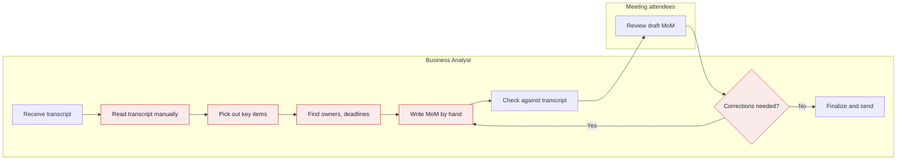

## 3. As-is workflow

### 3.1 Process summary

- **Trigger:** A meeting ends and a transcript is available (A-02).
- **Inputs:** Raw meeting transcript (Stated).
- **Outputs:** A Minutes of Meeting document with discussion points, decisions, action items, owners and deadlines, sent to attendees and stakeholders (Stated for content; A-06 for recipients).
- **People involved:** Business Analyst, meeting attendees.

### 3.2 Steps

| Step | Actor | What happens | Tool or document | Pain points |
|---|---|---|---|---|
| 1 | Business Analyst | Receives the raw transcript after the meeting | Transcript (A-02) | None |
| 2 | Business Analyst | Reads the transcript manually from start to end | Transcript | P-02 |
| 3 | Business Analyst | Picks out discussion points, decisions and action items | Transcript, own notes (A-03) | P-01 |
| 4 | Business Analyst | Finds the owner and deadline of each action | Transcript, attendees (A-06) | P-03 |
| 5 | Business Analyst | Writes the MoM by hand | Word-processing document (A-03) | P-04 |
| 6 | Business Analyst | Checks the draft against the transcript | Draft MoM, transcript | None |
| 7 | Meeting attendees | Review the draft MoM | Draft MoM (A-05) | None |
| 8 | Business Analyst | Applies corrections if attendees report any, then returns to step 5 | Draft MoM | P-05 |
| 9 | Business Analyst | Finalizes and sends the MoM | Email (A-06) | None |

### 3.3 Diagram

Legend: red steps carry a pain point from section 2.4.
