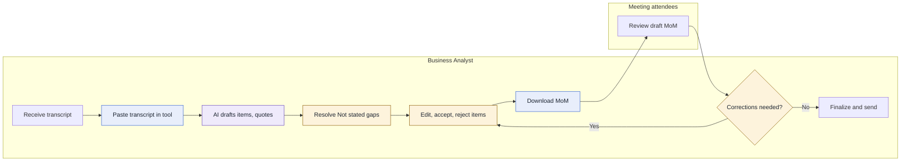

## 6. To-be workflow

### 6.1 What changes

| As-is step | Change | To-be step | Why it matters |
|---|---|---|---|
| 1 Receive transcript | Kept | 1 | Trigger is unchanged [A-02] |
| 2 Read transcript manually | Changed | 2 Paste transcript into the tool | BA time moves from reading to reviewing (P-02) |
| 3 Pick out key items | Changed | 3 AI drafts items with quotes | A first pass covers the whole transcript, each item tied to a quote (P-01) |
| 4 Find owners and deadlines | Changed | 4 BA resolves "Not stated" gaps | Gaps are listed with a suggested question, so none is overlooked (P-03) |
| 5 Write MoM by hand | Changed | 5 BA edits, accepts or rejects items | Layout is consistent and the BA edits instead of writing from scratch (P-04) |
| 6 Check against transcript | Changed | 5 (merged) | Quotes make the check item by item, inside the same step |
| None | New | 6 Download MoM | One Word file that records each decision and the prompt version, model and time |
| 7 Review draft MoM | Kept | 7 | Attendees still review (A-05) |
| 8 Apply corrections | Changed | 8 | The BA fixes items in the tool and downloads again, instead of rewriting (P-05) |
| 9 Finalize and send | Kept | 9 | The BA decides what is sent (N-05) |

### 6.2 Steps

| Step | Actor | What happens | Tool or document | Done by |
|---|---|---|---|---|
| 1 | Business Analyst | Receives the raw transcript after the meeting | Transcript (A-02) | Person |
| 2 | Business Analyst | Pastes the transcript into the tool. Rules reject empty or oversized input | MoM Drafter | Person |
| 3 | Business Analyst | The tool drafts discussion points, decisions and actions, each with a quote. A validator removes any item without a matching quote | MoM Drafter | AI |
| 4 | Business Analyst | Reviews the "Not stated" owners and deadlines, and asks attendees where needed | MoM Drafter, attendees | Person |
| 5 | Business Analyst | Checks each item against its quote, then accepts, edits or rejects it | MoM Drafter | Person |
| 6 | Business Analyst | Downloads the MoM as a Word document | Word file (.docx) | Rule |
| 7 | Meeting attendees | Review the draft MoM | Word file | Person |
| 8 | Business Analyst | Applies corrections in the tool and downloads again, or goes on to step 9 | MoM Drafter | Person |
| 9 | Business Analyst | Finalizes and sends the MoM | Email (A-06) | Person |

### 6.3 Diagram

Legend: blue steps are changed or new, purple is AI, amber is a human decision.

### 6.4 What stays with people

- **Whether each item is correct (step 5):** AI can omit or misstate an item, so the BA checks every item against its quote and accepts, edits or rejects it.
- **Owners and deadlines (step 4):** The tool never guesses them. The BA asks attendees and enters the answer.
- **Whether corrections are needed (step 8):** Attendees report them and the BA decides what changes.
- **What is sent and to whom (step 9):** The tool sends nothing, so the BA stays accountable (A-04).
