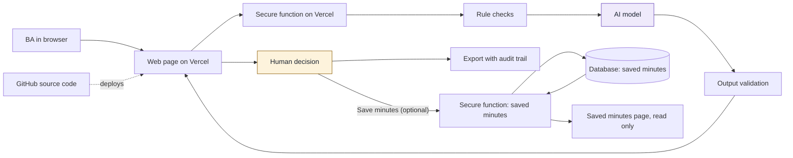

## 9. How it works and how AI stays under control

### 9.1 How AI works in the tool

| Stage | Done by | What happens |
|---|---|---|
| Input | Person | The BA pastes one English transcript of a single meeting [A-07] |
| Rule checks | Rules | The tool rejects empty or too-long text and checks the access code. No AI is involved |
| Analysis or drafting | AI | AI reads the transcript and drafts discussion points, decisions and actions, each with a short quote. It writes "Not stated" for any missing owner or deadline and suggests a question for the BA to ask |
| Validation | Rules | Every AI result must match the agreed format and quote its source text. Anything else is removed. Any owner or deadline that does not appear in the transcript is replaced with "Not stated" |
| Decision | Person | The BA accepts, edits or rejects each result |
| Export | Tool | The output records what was decided, with the prompt version, model and time. It does not record how many items the checks removed or replaced (L-10) |
| Save (optional, live mode only) | Person, then Rules | The BA chooses "Save minutes". The server checks the access code and the size and shape of the data, then stores the reviewed items and decisions. No AI is involved, and the server does not re-run the quote check because it does not have the transcript (L-14) |
| Read again | Person, then Tool | The BA opens the Saved minutes page, with the access code, and reads a record. It is read only and shows the decisions, the prompt version, model, run time and the removed and replaced counts |

### 9.2 Architecture and tech stack

Purple is AI and amber is the human decision. The save path has no AI step, and the transcript does not take it: only the reviewed items and decisions go to the database.

| Part | Choice | Why |
|---|---|---|
| Hosting, screens and backend | Vercel | One place to run everything, with no servers to manage. The secure function keeps the AI key out of the browser |
| Source code | GitHub | Full history of every change, and automatic deployment |
| AI model | Claude, with the model name set in server settings. The deployed model is `claude-haiku-5-5`, prompt v1 | Returns the structured format the validator needs. The model can be changed without editing code. Only Haiku was tried, on a few short fictional transcripts, so quality on other models or longer transcripts is unknown |
| Database and storage | Supabase, for saved minutes only (FN-09, added after G5). Level 1 plus storage: a database with no sign-in. The table has Row Level Security on and no public access, so only the secure function, using a server-only secret key, can read or write it | The team chose to show stored minutes. Nothing else is stored: not the transcript, not the access code. The rows are shared by everyone with the access code, and there is no delete (L-12). The saving feature is built on branch `feature/save-minutes` and works on its Vercel preview. It is not on production until the branch is merged |

### 9.3 Data safety

- **What the tool receives:** Pasted meeting transcript text and the BA's edits. It's used with fictional data only.
- **Where data goes:** From the BA's browser to a Vercel function, then to the AI provider, and back to the browser. If the BA chooses "Save minutes", the reviewed items and decisions also go from the browser to a second Vercel function and on to the Supabase database.
- **What's kept:** The transcript is never kept by the tool, and `/api/analyze` stores nothing and logs no transcript text. Exports stay with the user. Saved minutes are the one exception, and only when the BA chooses to save. A saved record holds the title, every item (including rejected and Not reviewed items) with its text, quote, owner, deadline and decision, the BA's edits and gap answers, the decision times, the prompt version, model, AI run time and the removed and replaced counts. The quotes are short extracts of the transcript. There is no delete, no edit and no retention rule, and saving again keeps a new copy (L-12).
- **Access:** The AI key and the database key stay on the server, and the tool requires an access code for drafting, saving and reading. There is no per-user sign-in: everyone with the access code shares one workspace and can read every saved record (L-12, R-10). The database table has Row Level Security on with no public access, so the browser cannot reach it directly. A person with access to the Supabase project can still read or delete rows.
- **Before real use:** Approval of the AI provider and Vercel and Supabase hosting for company data, a data classification of real transcripts and of saved minutes (they may hold personal or confidential content), a retention and delete rule for saved minutes, per-user sign-in, and a decision on who may read which records (Level 2).

### 9.4 Human control points

| Control point | Who decides | What happens without approval |
|---|---|---|
| Paste a transcript and run the draft (step 2) | Business Analyst | Nothing is sent to AI |
| Resolve "Not stated" owners and deadlines (step 4) | Business Analyst | The MoM keeps "Not stated". The AI is told not to guess, and any name or date that does not appear in the transcript is replaced with "Not stated" |
| Accept, edit or reject each item (step 5) | Business Analyst | Items not accepted are left out of the downloaded MoM, or are marked as not reviewed |
| Save the reviewed minutes (optional, after step 5, live mode only) | Business Analyst | Nothing is stored. Saving is never automatic, and the Word download works either way |
| Decide whether corrections are needed (step 8) | Business Analyst, from attendee feedback | The draft goes to step 9 unchanged |
| Send the final MoM (step 9) | Business Analyst | The tool sends nothing; the MoM stays with the BA |

Changed after G4: named the deployed model and prompt version, said that only Haiku was tried on a few short transcripts, removed the claim that the model "reads long text well" (not tested), and added that the Audit trail does not show the removed and replaced counts. The Anthropic SDK wording was dropped because as-built.md does not confirm it.

Changed after G5: FN-09 added the optional save path, the database and the Saved minutes page, by a decision of Viet on 2026-11-03. The statements "Database and storage: None", "nothing is stored by the tool" and "Level 1" were no longer true of saved minutes, and were reworded to name the transcript and unsaved work as the parts that are still not stored. Saving works on the branch's preview. It is not on production until the merge.
