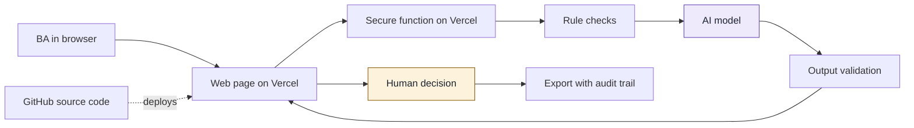

## 9. How it works and how AI stays under control

### 9.1 How AI works in the tool

| Stage | Done by | What happens |
|---|---|---|
| Input | Person | The BA pastes one English transcript of a single meeting [A-07] |
| Rule checks | Rules | The tool rejects empty or too-long text and checks the access code. No AI is involved |
| Analysis or drafting | AI | AI reads the transcript and drafts discussion points, decisions and actions, each with a short quote. It writes "Not stated" for any missing owner or deadline and suggests a question for the BA to ask |
| Validation | Rules | Every AI result must match the agreed format and quote its source text. Anything else is removed. Any owner or deadline that does not appear in the transcript is replaced with "Not stated" |
| Decision | Person | The BA accepts, edits or rejects each result |
| Export | Tool | The output records what was decided, with the prompt version, model and time |

### 9.2 Architecture and tech stack

Purple is AI and amber is the human decision.

| Part | Choice | Why |
|---|---|---|
| Hosting, screens and backend | Vercel | One place to run everything, with no servers to manage. The secure function keeps the AI key out of the browser |
| Source code | GitHub | Full history of every change, and automatic deployment |
| AI model | Claude, through Anthropic's official SDK, with the model name set in server settings | Reads long text well and returns the structured format the validator needs. The model can be changed without editing code |
| Database and storage | None at Level 1 | Storing nothing reduces data risk. Supabase is the next step if history is needed |

### 9.3 Data safety

- **What the tool receives:** Pasted meeting transcript text and the BA's edits. It's used with fictional data only.
- **Where data goes:** From the BA's browser to a Vercel function, then to the AI provider, and back to the browser.
- **What's kept:** Level 1: nothing is stored by the tool. Exports stay with the user.
- **Access:** The AI key stays on the server, and the tool requires an access code.
- **Before real use:** Approval of the AI provider and Vercel hosting for company data, a data classification of real transcripts (they may hold personal or confidential content), and a decision on whether history is needed (Level 2).

### 9.4 Human control points

| Control point | Who decides | What happens without approval |
|---|---|---|
| Paste a transcript and run the draft (step 2) | Business Analyst | Nothing is sent to AI |
| Resolve "Not stated" owners and deadlines (step 4) | Business Analyst | The MoM keeps "Not stated". The AI is told not to guess, and any name or date that does not appear in the transcript is replaced with "Not stated" |
| Accept, edit or reject each item (step 5) | Business Analyst | Items not accepted are left out of the downloaded MoM, or are marked as not reviewed |
| Decide whether corrections are needed (step 8) | Business Analyst, from attendee feedback | The draft goes to step 9 unchanged |
| Send the final MoM (step 9) | Business Analyst | The tool sends nothing; the MoM stays with the BA |
