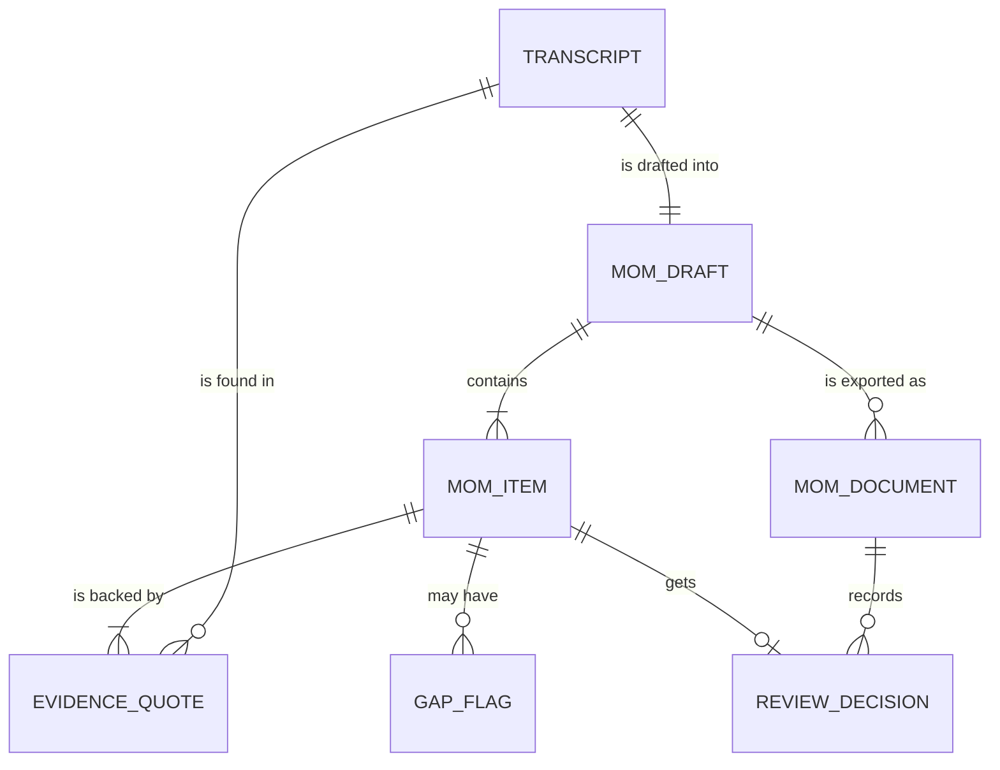

## A1. Domain model

### A1.1 Actors

| ID | Actor | Type | Goal | Features used |
|---|---|---|---|---|
| ACT-01 | Business Analyst | Person | Turn a transcript into an accurate MoM, check every item and decide what goes into the file that is sent | CF-01, CF-02, CF-03 |
| ACT-02 | Meeting attendees | Person | Answer the BA's questions about missing owners and deadlines, then review the downloaded MoM and report corrections. They work in the Word file and by talking to the BA, not in the tool [A-05, A-06] | CF-02, CF-03 |
| ACT-03 | AI model | System | Read the transcript, draft items with quotes, and mark missing owners and deadlines as "Not stated" with a suggested question. It is Claude, reached through the AI provider's service | CF-01, CF-02 |
| ACT-04 | MoM Drafter | System | Apply the rule checks, remove AI results that fail validation, hold the BA's decisions during the session, and build the Word file with the audit trail | CF-01, CF-02, CF-03 |

Stakeholders outside the meeting only receive the finished MoM by email from the BA (A-06). They don't use the tool, so they are not actors.

### A1.2 Business objects

| ID | Object | Meaning | Key attributes | Created by | Sensitivity |
|---|---|---|---|---|---|
| OBJ-01 | Transcript | The raw text of one English meeting, pasted by the BA [A-07] | Text, meeting title (optional) | ACT-01 | Fictional in the prototype. In real use it may hold personal or confidential business content |
| OBJ-02 | MoM draft | The structured first draft of the minutes for one meeting. It collects all items from one run | Items, created time, prompt version, model name | ACT-04, from the output of ACT-03 | Fictional in the prototype. In real use it carries the same content as the transcript |
| OBJ-03 | MoM item | One discussion point, decision or action in the draft | Type (discussion point, decision or action), text, owner and deadline (actions only), review status | ACT-03; ACT-01 may change the text | Fictional in the prototype. In real use it may name people and commitments |
| OBJ-04 | Evidence quote | A short extract of the transcript that backs one item. An item with no matching quote is removed | Quote text, the item it supports | ACT-03; ACT-04 checks it against OBJ-01 | Fictional in the prototype. In real use it is a copy of transcript text, so it has the transcript's sensitivity |
| OBJ-05 | Gap flag | A marker that an action has no stated owner or no stated deadline | Which field (owner or deadline), value "Not stated", suggested question, answer entered by the BA | ACT-03; ACT-01 enters the answer | Fictional in the prototype. In real use the answer is a name or date from attendees |
| OBJ-06 | Review decision | The record of what the BA decided for one item | Item, decision (accepted, edited or rejected), edited text, time | ACT-01 | Fictional in the prototype. In real use it is the audit trail of who decided what, so it should be kept with the MoM |
| OBJ-07 | MoM document | The Word (.docx) file the BA downloads and sends [A-09]. It shows the accepted and edited items and records each decision | Sections of items with quotes, decisions, prompt version, model, time of export | ACT-04 | Fictional in the prototype. In real use it is a company record that the BA stores and shares |

### A1.3 Data model

Entity names map to the objects: TRANSCRIPT is OBJ-01, MOM_DRAFT is OBJ-02, MOM_ITEM is OBJ-03, EVIDENCE_QUOTE is OBJ-04, GAP_FLAG is OBJ-05, REVIEW_DECISION is OBJ-06 and MOM_DOCUMENT is OBJ-07.

This is a conceptual model for Level 1, with no database. While the tool runs, OBJ-01 to OBJ-06 live only in the BA's browser page and are lost when the page is closed or reloaded [A-11]. The transcript text passes through a Vercel function to the AI provider for each run and is not stored there by the tool. OBJ-07 is a file on the BA's own computer, outside the tool. Saving history in tables is a Level 2 option and is not planned here.
