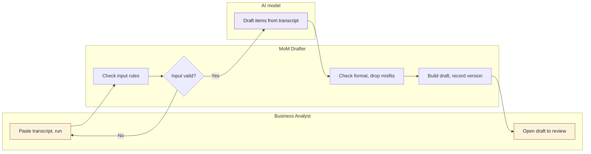
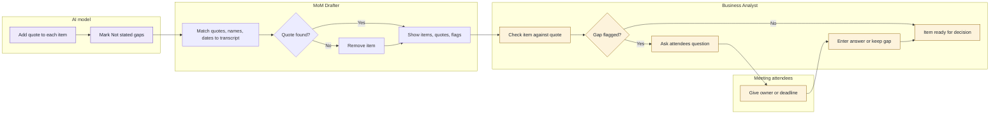
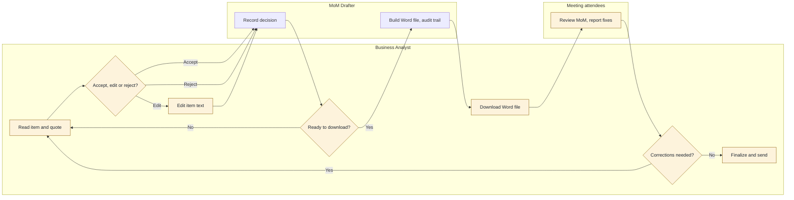

## A2. Feature workflows

Lanes follow the same order in every workflow: Business Analyst, Meeting attendees, MoM Drafter, AI model. A lane is left out when it has no step.

### WF-01 Draft a structured MoM from a transcript

- **Feature:** CF-01
- **Actors:** ACT-01, ACT-04, ACT-03
- **Trigger:** The BA has a raw transcript of one meeting and decides to run the draft (06 step 2)
- **Result:** A MoM draft of discussion points, decisions and actions, held in the browser and ready for the BA to review. If the input fails a rule check, nothing is sent to the AI model

| Step | Actor | Action | Objects |
|---|---|---|---|
| 1 | ACT-01 | Pastes the transcript and chooses to run the draft | OBJ-01 |
| 2 | ACT-04 | Checks the input rules: not empty, not too long, access code valid | OBJ-01 |
| 3 | ACT-04 | Decides whether the input is valid. If not, shows the reason and returns to step 1 | OBJ-01 |
| 4 | ACT-03 | Reads the transcript and drafts discussion points, decisions and actions | OBJ-01, OBJ-03 |
| 5 | ACT-04 | Checks that the result matches the agreed format and removes anything that doesn't | OBJ-03 |
| 6 | ACT-04 | Builds the MoM draft in one consistent layout and records the prompt version, model and time | OBJ-02, OBJ-03 |
| 7 | ACT-01 | Opens the draft to review it (continues in WF-02 and WF-03) | OBJ-02 |

Legend: purple is AI and amber is a human action or decision.

### WF-02 Check evidence quotes and resolve gaps

- **Feature:** CF-02
- **Actors:** ACT-03, ACT-04, ACT-01, ACT-02
- **Trigger:** The AI model is drafting items (WF-01 step 4)
- **Result:** Every item that reaches the BA has a quote that matches the transcript. Each missing owner or deadline shows "Not stated" with a suggested question, and the BA has either entered the answer from the attendees or kept "Not stated". The AI is told not to guess an owner or a deadline, and any name or date that does not appear in the transcript is replaced with "Not stated". The tool adds no owner or deadline of its own

| Step | Actor | Action | Objects |
|---|---|---|---|
| 1 | ACT-03 | Adds a short quote from the transcript to each item | OBJ-03, OBJ-04 |
| 2 | ACT-03 | Writes "Not stated" for any missing owner or deadline on an action and suggests a question to ask | OBJ-03, OBJ-05 |
| 3 | ACT-04 | Matches each quote against the transcript text, and checks that each owner and deadline wording appears in it. A name or date that does not appear is replaced with "Not stated" | OBJ-04, OBJ-05, OBJ-01 |
| 4 | ACT-04 | Decides whether the quote is found. If not, goes to step 5. If so, goes to step 6 | OBJ-04 |
| 5 | ACT-04 | Removes the item that has no matching quote | OBJ-03 |
| 6 | ACT-04 | Shows each remaining item with its quote and any gap flag | OBJ-03, OBJ-04, OBJ-05 |
| 7 | ACT-01 | Checks the item against its quote | OBJ-03, OBJ-04 |
| 8 | ACT-01 | Decides whether the item has a gap flag. If not, goes to step 12 | OBJ-05 |
| 9 | ACT-01 | Asks the attendees the suggested question, outside the tool | OBJ-05 |
| 10 | ACT-02 | Tell the BA the owner or deadline | OBJ-05 |
| 11 | ACT-01 | Enters the answer, or keeps "Not stated" if there is none | OBJ-03, OBJ-05 |
| 12 | ACT-01 | Treats the item as ready for the accept, edit or reject decision (WF-03) | OBJ-03 |

Legend: purple is AI and amber is a human action or decision.

### WF-03 Review, edit and download the MoM

- **Feature:** CF-03
- **Actors:** ACT-01, ACT-04, ACT-02
- **Trigger:** The BA has a draft whose items have quotes and gap flags (end of WF-02)
- **Result:** A Word document that shows the accepted and edited items and records each decision with the prompt version, model and time. After attendee feedback, the BA can correct items and download again. The BA then sends the final MoM outside the tool

| Step | Actor | Action | Objects |
|---|---|---|---|
| 1 | ACT-01 | Reads one item and its quote | OBJ-03, OBJ-04 |
| 2 | ACT-01 | Decides to accept, edit or reject the item | OBJ-03 |
| 3 | ACT-01 | If editing, changes the item text | OBJ-03 |
| 4 | ACT-04 | Records the decision and sets the item's review status | OBJ-06, OBJ-03 |
| 5 | ACT-01 | Decides whether to download now. If not, returns to step 1 for the next item | OBJ-02 |
| 6 | ACT-04 | Builds the Word file. Rejected items are left out and items not yet decided are marked as not reviewed [A-10] | OBJ-07, OBJ-06 |
| 7 | ACT-01 | Downloads the Word file | OBJ-07 |
| 8 | ACT-02 | Review the Word file and report corrections to the BA | OBJ-07 |
| 9 | ACT-01 | Decides whether corrections are needed. If so, returns to step 1 | OBJ-07 |
| 10 | ACT-01 | Finalizes and sends the MoM by email, outside the tool | OBJ-07 |

Legend: amber is a human action or decision. No step in this workflow uses AI.

### Coverage check

| Feature | Workflow | To-be steps in section 6 | Control points in section 9.4 |
|---|---|---|---|
| CF-01 | WF-01 | 2, 3 | Paste a transcript and run the draft |
| CF-02 | WF-02 | 3, 4 | Resolve "Not stated" owners and deadlines |
| CF-03 | WF-03 | 5, 6, 7, 8, 9 | Accept, edit or reject each item; decide whether corrections are needed; send the final MoM |
