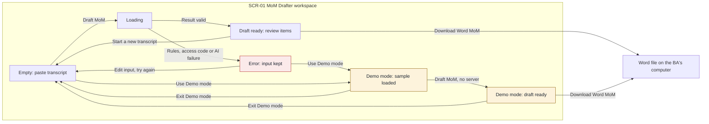

## A4. Screens

### A4.1 Screen list

One screen with clear states. The whole job (paste, draft, review, download) fits on one page, so a second or third screen would only add clicks. Demo mode is a state of this screen, not a separate screen.

| ID | Screen | Purpose | Actors | Functions |
|---|---|---|---|---|
| SCR-01 | MoM Drafter workspace | Paste a transcript, get a draft MoM with quotes and gap flags, decide on every item, and download the Word file. Also runs in Demo mode | ACT-01 | FN-01, FN-02, FN-03, FN-04, FN-05 |

### A4.2 Sitemap

Legend: amber is Demo mode and red is the error state. There is no sign-in screen at Level 1. The access code is a field on SCR-01.

### A4.3 Screen specifications

#### SCR-01 MoM Drafter workspace

- **Purpose:** The BA pastes one fictional transcript, gets a draft MoM in which every item has a transcript quote, resolves missing owners and deadlines, accepts, edits or rejects each item, and downloads the Word file. Traces to CF-01, CF-02 and CF-03.
- **Layout:**
  - `.app-header`: the name "MoM Drafter", the tagline "Draft meeting minutes from a transcript. You check and decide every item.", and the `.mode-label` slot (empty in live mode).
  - `.page-split`: two columns on wide screens, one column on narrow screens (input first, results second).
  - Left column, a `.panel` titled "Transcript": the fictional data `.notice`, the optional title `.field`, the access code `.field`, the transcript `.field` with a character count, and the buttons.
  - Right column, a `.panel` titled "MoM draft": the `.summary` bar, the `.notice` for removed items, the three groups of `.item` results (Discussion points, Decisions, Action items), and the download area at the foot.
  - A session `.notice` (`.notice-warn`) sits above the right column whenever a draft is on screen.

| Element | Component | Behavior | Function |
|---|---|---|---|
| Tool name and tagline | `.app-header` | Always visible | FN-01 |
| Mode label "Demo mode: sample data, no AI" | `.mode-label` | Visible only in Demo mode, in every Demo mode state. Hidden in live mode | FN-05 |
| Fictional data reminder | `.notice` | Always visible above the transcript box. Text: "Use fictional data only. Do not paste real names, company details or confidential content." | FN-01 |
| Meeting title (optional) | `.field` with `input` | Free text. Used as the heading and file name of the Word file. Not sent to the AI | FN-04 |
| Access code | `.field` with `input` (password type) | Required in live mode. Sent as the `x-access-code` header, kept in the page only, never saved. Hidden in Demo mode | FN-01 |
| Transcript box | `.field` with `textarea` | Takes the pasted text. Label "Meeting transcript". Shows a count, for example "12,400 of 20,000 characters" [A-12]. Turns to the error style above the limit. The browser checks empty and too-long text when "Draft MoM" is chosen, before any request | FN-01 |
| "Draft MoM" | `.btn .btn-primary` | The one main action. In live mode it starts FN-01. In Demo mode it loads the saved sample result and makes no server call. Disabled while loading | FN-01, FN-05 |
| "Use Demo mode" | `.btn` | Starts Demo mode: shows the label, loads the sample transcript, hides the access code. Loads the main sample, or the stress-test sample when the page address carries `?sample=stress` (no extra button) | FN-05 |
| "Exit Demo mode" | `.btn` | Replaces "Use Demo mode" while Demo mode is on. Clears the box and the draft, removes the label | FN-05 |
| "Start a new transcript" | `.btn` | Appears when a draft is on screen. Asks "Start over? Your draft and decisions will be lost unless you have downloaded the Word file." with "Cancel" and "Start over" | FN-03 |
| Session warning | `.notice .notice-warn` | Shown while a draft is on screen: "This draft is kept only in this page. Download the Word file before you close or reload." | FN-03 |
| Summary bar | `.summary` with `.summary-item` | Counts: Items, Accepted, Edited, Rejected, Not reviewed, Open gaps, Removed by quote check, Replaced by name and date check. Open gaps counts flags, not actions: each `Not stated` owner and each `Not stated` deadline is one gap. Updates after every decision | FN-02, FN-03 |
| Removed-items notice | `.notice` | Shown when `droppedCount` is above zero: "N items were removed because their quote was not found in the transcript." (singular for 1: "1 item was removed because its quote was not found in the transcript.") | FN-02 |
| Replaced-values notice | `.notice` | Shown when `replacedCount` is above zero: "N owner or deadline values were replaced with Not stated because they were not found in the transcript." (singular for 1: "1 owner or deadline value was replaced with Not stated because it was not found in the transcript.") | FN-02 |
| Group headings | Plain headings | "Discussion points", "Decisions", "Action items". A group with no items shows "None found." | FN-01 |
| Result item | `.item` with `data-decision` of `accepted`, `edited` or `rejected` | One MoM item. Not reviewed items have no `data-decision`. Rejected items are dimmed and labelled "Rejected" | FN-03 |
| Source badge | `.badge .badge-ai` or `.badge-rule` | Each item shows "AI". Each gap flag shows "Rule" (set by the rule that the field is `Not stated`) | FN-01, FN-02 |
| Review status badge | `.badge` with text | "Not reviewed", "Accepted", "Edited" or "Rejected". Text always present, never color alone | FN-03 |
| Item text | Plain text, selectable | The one-sentence item. In edit mode it becomes a `textarea` with "Save edit" and "Cancel" | FN-03 |
| Evidence quote | `.quote` | The transcript quote under every item. Never changes after an edit | FN-01, FN-02 |
| Gap flag (owner, deadline) | `.notice .notice-warn` inside the item | Shown on an action when owner or deadline is `Not stated`: "Owner: Not stated" or "Deadline: Not stated", with the suggested question, a `.field` "Answer from attendees" and a "Save answer" `.btn`. After saving, shows the value with the badge "Entered by BA" | FN-03 |
| Decision buttons | `.decision` wrapping three `.btn` | "Accept", "Edit", "Reject" on every item. The chosen one is marked and the others stay available | FN-03 |
| Unreviewed notice | `.notice` | Above the download button when any item is Not reviewed: "N items are not reviewed. They will be marked Not reviewed in the file." | FN-04 |
| "Download Word MoM" | `.btn .btn-primary` | Builds and saves the .docx in the browser, using the library file served by the tool itself, so it works offline and in Demo mode. Disabled when there is no draft | FN-04 |
| Audit line | Plain small text | Under the download button: "Prompt version v1, model <name>, drafted <time>". In Demo mode: "Sample data, no AI" | FN-04, FN-05 |
| Error notice | `.notice .notice-error` | Plain-language message, with a "Use Demo mode" button | FN-01, FN-02, FN-04, FN-05 |
| Empty state | `.empty` | Shown in the right column before a draft exists | FN-01 |
| Loading state | `.loading` | Shown while the draft is being made | FN-01 |

| State | What the user sees |
|---|---|
| Empty | Header without a mode label. Left column: the fictional data notice, the empty title, access code and transcript fields, "Draft MoM" and "Use Demo mode". Right column: `.empty` reading "No draft yet. Paste a transcript on the left and choose Draft MoM, or choose Use Demo mode to see a sample." "Download Word MoM" is disabled |
| Loading | "Draft MoM" is disabled. Right column: `.loading` reading "Reading the transcript and drafting the MoM." The transcript box keeps its text |
| Success | Right column shows the session warning, the summary bar (every item starts as Not reviewed), the removed-items notice and the replaced-values notice if any, and the items grouped as Discussion points, Decisions and Action items. Every item has the AI badge, its text, its quote and Accept, Edit and Reject. Actions with gaps show the flags with the suggested question. "Download Word MoM" is enabled |
| Error | `.notice-error` above the right column, with exact text from FN-01: "Paste a transcript before you draft the MoM." / "This transcript is longer than the 20,000-character limit. Shorten it, for example by removing small talk, then try again." / "The access code is missing or not correct. Enter the code you were given, or use Demo mode." / "The draft could not be created, and nothing was changed. Try again, or use Demo mode to see a sample." / "The AI returned a result in the wrong format, so it was not shown. Try again, or use Demo mode to see a sample." The transcript stays in the box. The empty and too-long messages appear at once, from the browser, with no request sent, and take priority over the access code message. A "Use Demo mode" button is next to the message. A file error (including the Word library file failing to load) shows "The Word file could not be created. Your decisions are still on screen. Try again, or select the text on the screen and copy it into a document." The draft and decisions stay unchanged |
| No items matched | Right column reads "No item could be matched to the transcript. Check the transcript text and try again, or use Demo mode." with the removed-items notice. "Download Word MoM" is disabled |
| Demo mode | The label "Demo mode: sample data, no AI" shows in the header. The sample transcript is in the box, the access code field is hidden, and "Use Demo mode" is replaced by "Exit Demo mode". After "Draft MoM" the sample draft appears with no server call, after the browser has run the same quote check and name and date check as in live mode on the saved items. The removed and replaced counts and notices come from that check, not from the sample file. With `?sample=stress` the transcript box starts with the line "[STRESS-TEST SAMPLE. Fictional data only. Used to show the quote check removing one item. Not the main demo.]", and the draft shows 4 items with the notice "1 item was removed because its quote was not found in the transcript." Everything else (quotes, flags, decisions, download) works as in Success, with no server and no internet connection needed. The audit line reads "Sample data, no AI". If the samples fail to load: "The sample data could not be loaded. Reload the page and try again." |

**Item states**

| Item state | What the user sees on the item |
|---|---|
| Not reviewed | Badge "Not reviewed", no `data-decision`, buttons Accept, Edit, Reject |
| Accepted | `data-decision="accepted"`, badge "Accepted" |
| Editing | The text is a `textarea` with "Save edit" and "Cancel". The quote stays visible. An empty save shows "Item text can't be empty. Enter text, or choose Reject." |
| Edited | `data-decision="edited"`, badge "Edited", the new text, the original quote |
| Rejected | `data-decision="rejected"`, dimmed, badge "Rejected". The buttons stay so the BA can change the decision |

**Writing on screen:** Buttons say what happens ("Draft MoM", "Download Word MoM"). No exclamation marks. The screen never says the draft is accurate; the closest wording is the tagline, "You check and decide every item."

**Accessibility:** Keep the visible focus styles. Badges always carry text. Item text and quotes stay selectable so the BA can copy them. Check the screen at presentation zoom before G5.

**Traceability check:** Every Must function appears on SCR-01 (FN-01 to FN-05), and every element in the table names a function.
